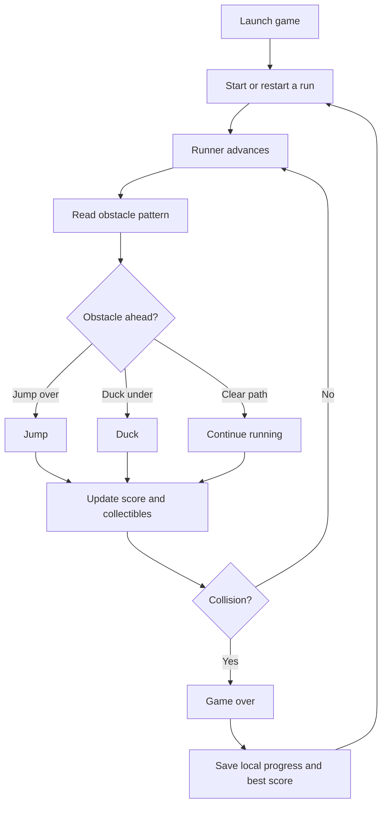

# MONKEY NEON RUN

**A neon-styled, browser-based endless runner.**

A lightweight Canvas game with keyboard and touch controls.

---

## Overview

Monkey Neon Run is a single-page arcade runner. Players guide a monkey through obstacle patterns, time jumps and ducks, and try to improve their personal score across increasingly challenging runs.

## Gameplay

- Jump over hazards and duck under obstacles.
- Play with keyboard controls or the on-screen mobile controls.
- Progress through changing obstacle patterns and difficulty tiers.
- Track score, best score, collected bananas, and local play history.
- Adjust to different viewport sizes with a responsive Canvas layout.

The game source documents 22 obstacle-wave patterns across seven difficulty tiers. Progress and high-score data are stored locally in the browser using localStorage.

## Controls

| Action | Desktop | Touch device |
| --- | --- | --- |
| Jump | Space or Arrow Up | JUMP button or tap the game area |
| Duck | Hold Arrow Down | Hold DUCK |

## Gameplay loop

## Technology

- HTML5
- CSS3
- Vanilla JavaScript
- HTML Canvas 2D API
- Browser localStorage

## Run locally

No dependency installation or build command is required.

    git clone https://github.com/gusti111/monkey-neon-run.git
    cd monkey-neon-run
    python -m http.server 8000

Open http://localhost:8000 in a modern browser.

## Project structure

    monkey-neon-run/
    ├── index.html
    └── LICENSE

The game interface, styling, and JavaScript logic are bundled in index.html.

## Project status and limitations

This is a browser game prototype. Player progress is stored per browser and is not synchronized across devices. The repository does not include an online leaderboard, accounts, or a server-side score service.

## Author

**Gusty Faqikh** · [GitHub](https://github.com/gusti111)